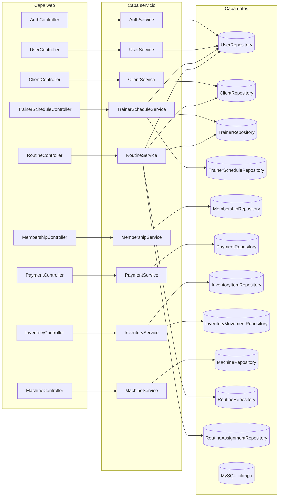
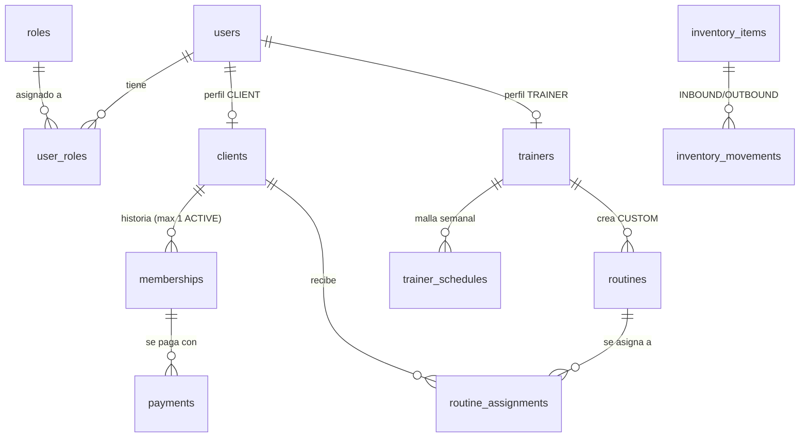
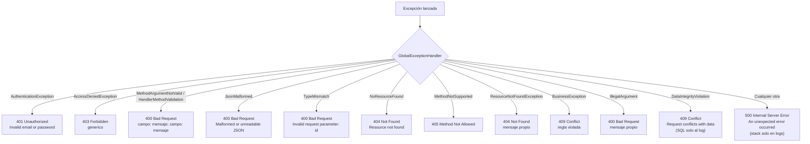

# 🏛️ Olimpo — Arquitectura y flujo del código

Documentación para entender cómo viaja una petición dentro del backend y cómo se conectan los módulos.

---

## 1. Flujo de una petición (ciclo completo)

```mermaid
sequenceDiagram
    autonumber
    participant C as Cliente (Postman / Frontend)
    participant SC as SecurityFilterChain<br/>(SecurityConfig)
    participant JWT as JwtAuthenticationFilter
    participant CT as Controller<br/>(@PreAuthorize)
    participant SV as Service<br/>(Reglas de negocio)
    participant RP as Repository
    participant DB as MySQL (olimpo)
    participant GH as GlobalExceptionHandler

    C->>SC: HTTP + Authorization: Bearer &lt;token&gt;
    SC->>JWT: filtra
    alt No hay header Bearer
        JWT->>SC: sigue sin autenticación
    else Token válido (firma + expiración)
        JWT->>JWT: isValid + loadUserByUsername
        JWT->>SC: SecurityContext con roles ROLE_x
    else Token corrupto
        JWT->>SC: SecurityContext vacío (try/catch)
    end
    SC->>CT: pasa al controller
    alt Sin permiso o sin sesión
        SC-->>C: 401 {"status":401,"error":"Unauthorized",...}
        Note over CT: @PreAuthorize bloquea antes del body
        CT-->>C: 403 Forbidden
    else Permiso OK
        CT->>SV: DTO validado (@Valid)
        alt Regla de negocio violada
            SV-->>GH: BusinessException / IllegalArgumentException
            GH-->>C: JSON {status, error, message}
        else Todo válido
            SV->>RP: JPA (parámetros vinculados)
            RP->>DB: SQL
            DB-->>RP: filas
            RP-->>SV: entidades
            SV-->>CT: Response DTO (nunca password_hash)
            CT-->>C: 200/201 + JSON
        end
    end
```

> **Punto clave**: cualquier excepción no prevista la atrapa el último handler
> (`Exception.class`) que devuelve un **500 genérico** y deja el detalle solo en el log del servidor.

---

## 2. Mapa de módulos (paquetes)



---

## 3. Modelo de dominio (relaciones)



- `users` es la raíz de identidad (email + BCrypt + estado) y los roles viven en `user_roles` (N:M).
- `clients` y `trainers` son perfiles 1:1 (opcional) por usuario, `user_id` UNIQUE.
- `memberships` es **historial**: índice único `(client_id, status)` garantiza máx. 1 ACTIVE; DAILY también es una membresía.
- `routines.price` solo aplica cuando `type = 'CUSTOM'`; GENERIC no lleva precio ni trainer.

---

## 4. Flujo de errores estandarizado



Formato único: `{"status": <int>, "error": <tipo>, "message": <texto seguro>}`.

---

## 5. Matriz de acceso por ruta

| Ruta | Métodos | Roles permitidos |
|------|---------|------------------|
| `/api/v1/auth/login` | POST | público |
| `/api/v1/auth/refresh`, `/me` | POST/GET | cualquiera autenticado |
| `/api/v1/users` (POST) | POST | ADMIN, RECEPCIONIST, TRAINER_MANAGER, TRAINER |
| `/api/v1/users` (list) | GET | **solo ADMIN** |
| `/api/v1/users/{id}` | GET | solo ADMIN |
| `/api/v1/users/{id}/roles` | PATCH | solo ADMIN |
| `/api/v1/clients` | POST/GET | ADMIN, RECEPCIONIST |
| `/api/v1/clients/{id}` | GET | ADMIN, RECEPCIONIST, CLIENT (solo el propio) |
| `/api/v1/clients/{id}/memberships` | GET | ADMIN, RECEPCIONIST, CLIENT (solo el propio) |
| `/api/v1/clients/{id}/routines` | GET | ADMIN, TRAINER_MANAGER, TRAINER, RECEPCIONIST, CLIENT (solo el propio) |
| `/api/v1/memberships` / `/active` / `{id}/renew` | PATCH/POST/GET | ADMIN, RECEPCIONIST (active también CLIENT) |
| `/api/v1/payments` | POST | ADMIN, RECEPCIONIST |
| `/api/v1/inventory/items/**` | todos | ADMIN, TRAINER_MANAGER, TRAINER |
| `/api/v1/machines/**` | todos | ADMIN, TRAINER_MANAGER, TRAINER |
| `/api/v1/trainers/{id}/schedules` | GET/POST | ADMIN, TRAINER_MANAGER (cualquiera), TRAINER (solo la propia) |
| `/api/v1/routines` (GET catálogo) | GET | cualquiera autenticado |
| `/api/v1/routines` (POST), `/{id}/assignments` | POST | ADMIN, TRAINER_MANAGER, TRAINER |
| `/api/v1/routines/{id}/assignments` | GET | ADMIN, TRAINER_MANAGER, TRAINER, RECEPCIONIST |

> Nota histórica del equipo: **RECEPCIONIST queda fuera del inventario** porque "a veces no está la recepcionista" y el staff deportivo lo gestiona.
